<div align="center">


<h1>Mitady</h1>

<p><b>« Mitady » veut dire « chercher » en malgache.</b><br>
Un outil <b>local</b> qui cherche des offres à ta place, mesure ta correspondance avec chacune,<br>
prépare <b>un CV et une lettre de motivation en PDF</b> adaptés à l'offre, et suit tes candidatures.</p>

<p>


</p>


</div>

## 🌳 L'essentiel

<table>
<tr>
<td width="33%" valign="top" align="center"><br><b>Il cherche partout</b><br>HelloWork, LinkedIn, Indeed, Welcome to the Jungle, Jobs That Make Sense, France Travail (et Jobijoba, JobTeaser, L'Étudiant en option). Alternance, stage, CDI, CDD ou freelance, dans tous les domaines. Une offre publiée sur plusieurs sites n'apparaît qu'une fois.</td>
<td width="33%" valign="top" align="center"><br><b>Il note chaque offre</b><br>Un score de correspondance calculé à partir des compétences citées dans l'annonce. Une compétence manque à ton profil alors que tu la maîtrises ? Un clic l'ajoute et tous les scores se recalculent.</td>
<td width="33%" valign="top" align="center"><br><b>Il prépare ton CV</b><br>Toujours en PDF : ton CV tel quel, ton Word adapté, ou l'un des 21 modèles de l'appli, avec un éditeur façon Flow CV (polices, couleurs, photo, titres, langue…). Seul le titre du poste change selon l'offre.</td>
</tr>
<tr>
<td valign="top" align="center"><br><b>Il écrit ta lettre</b><br>Une lettre de motivation assortie à ton CV, avec des variables (<code>{{entreprise}}</code>, <code>{{poste}}</code>…). Retouchable pour chaque offre, ou rédigée par Claude si tu ajoutes une clé API.</td>
<td valign="top" align="center"><br><b>Il suit tes candidatures</b><br>Un tableau par étape (à traiter, envoyées, entretiens, offres, refus), des relances au bon moment, l'envoi de l'e-mail avec le CV et la lettre en pièces jointes.</td>
<td valign="top" align="center"><br><b>Il a un animal</b><br>Un koala, un chat, un renard… en pixel art. Il se perche sur la barre de recherche, dort quand tu es ailleurs, et réagit quand tu le touches. Mode clair et sombre.</td>
</tr>
</table>

<div align="center">
<br><sub>Pendant une recherche, chaque site a son animal : il saute, et annonce les nouvelles offres trouvées.</sub>
</div>

## 🎬 La présentation animée

<p align="center">
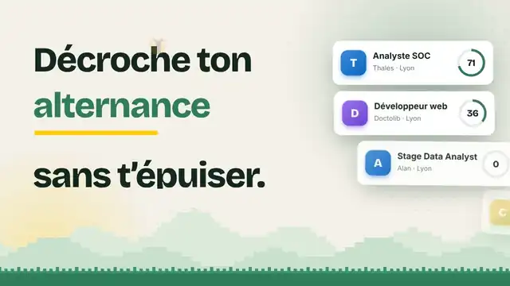
</p>

Une présentation de 72 secondes, en motion graphique et avec sa musique, est incluse : [`promo/mitady-promo.html`](promo/mitady-promo.html). C'est un seul fichier, sans connexion nécessaire : ouvre-le dans ton navigateur (`Espace` pause, `←`/`→` saute de 5 s, `F` plein écran, `M` coupe ou remet le son ; clique sur « Activer le son », les navigateurs l'exigent). La musique est originale, synthétisée par le code : un groove chiptune à 120 BPM, avec des bruitages sur chaque animation.

<details>
<summary>La fabriquer ou l'exporter en vidéo</summary>

```bash
node --experimental-default-type=module promo/build.mjs   # régénère promo/mitady-promo.html
node promo/make-audio.mjs                                 # régénère la musique (promo/assets/theme.mp3)
node promo/export.mjs                                     # rend promo/mitady-promo.mp4 avec le son (ffmpeg requis)
node promo/export.mjs --width 1920 --fps 60               # en Full HD, 60 images par seconde
```

Chaque image est une fonction du temps : l'export est donc exact, image par image. Les scènes sont dans `promo/scenes.js`, le moteur dans `promo/template.html`, la musique dans `promo/make-audio.mjs`.
</details>


## 📸 Aperçu

<p align="center">
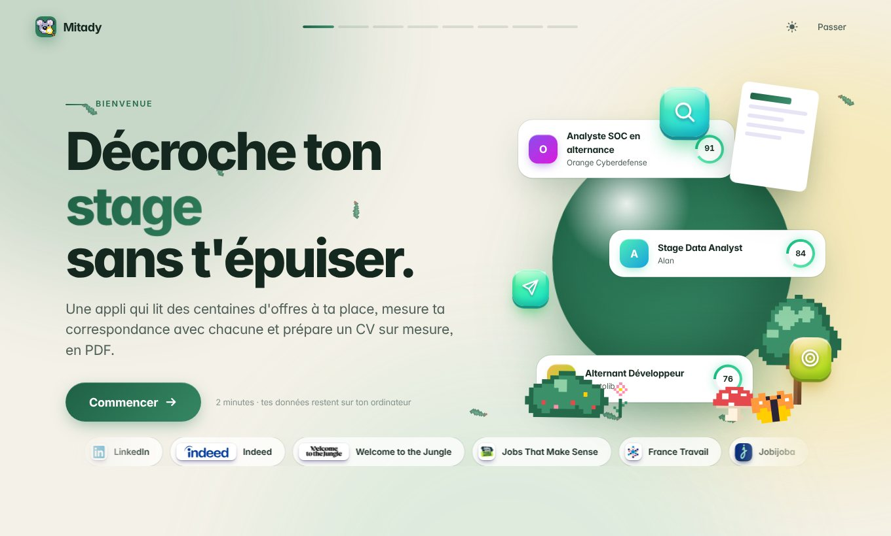
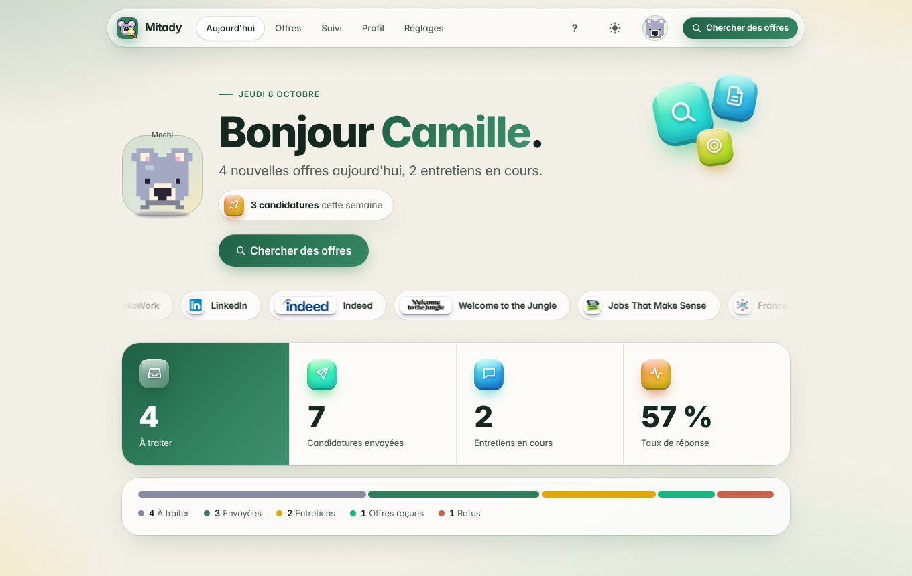
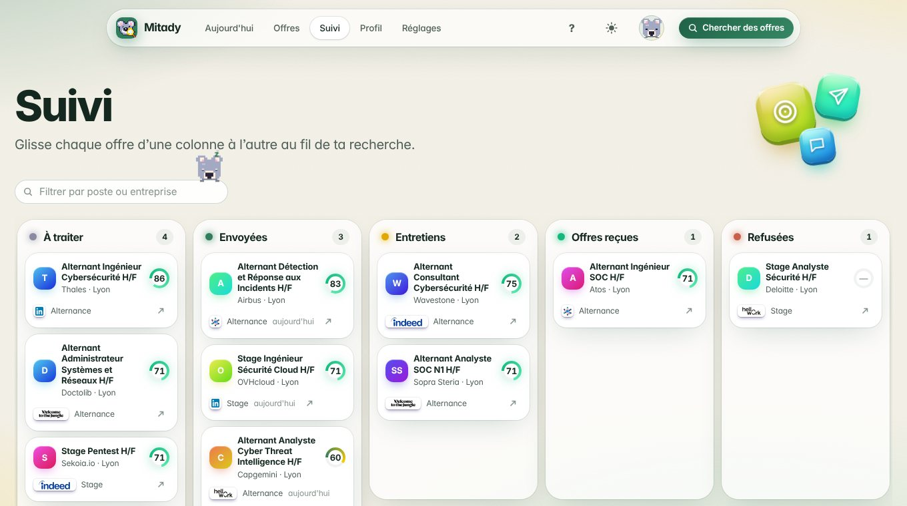
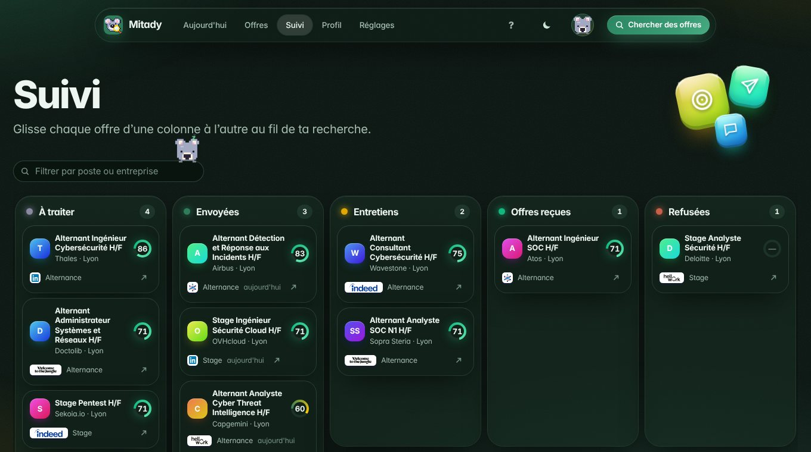
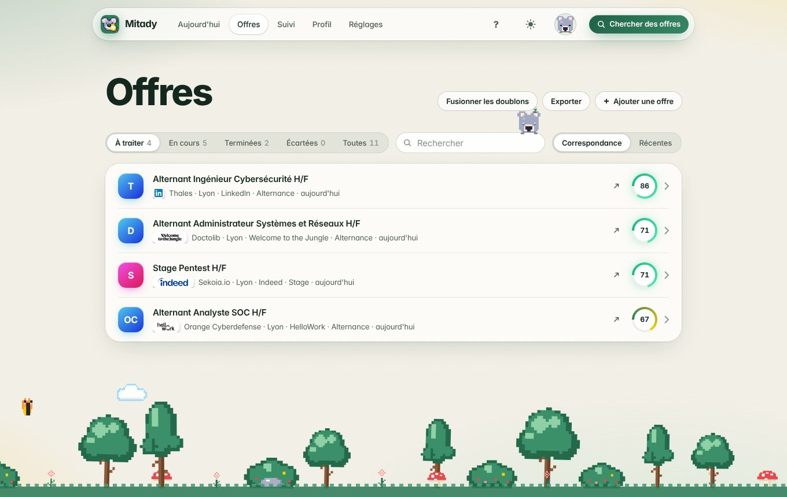
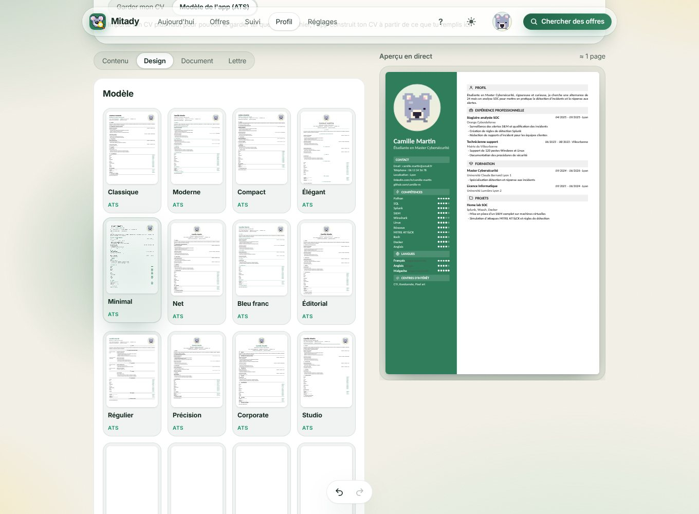
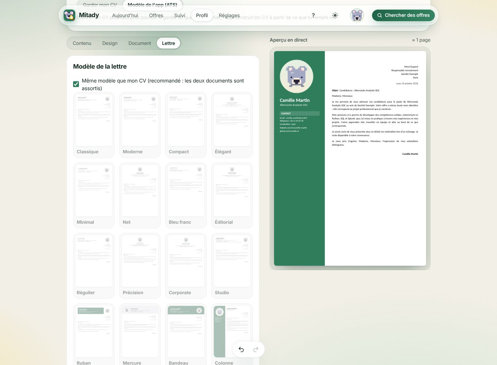
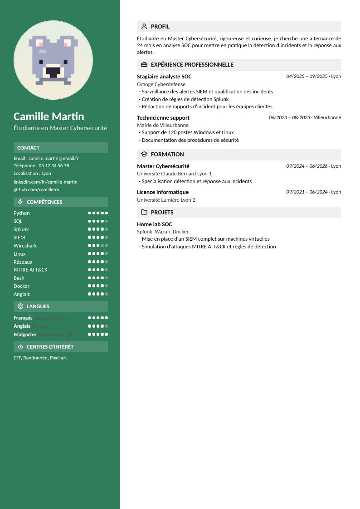
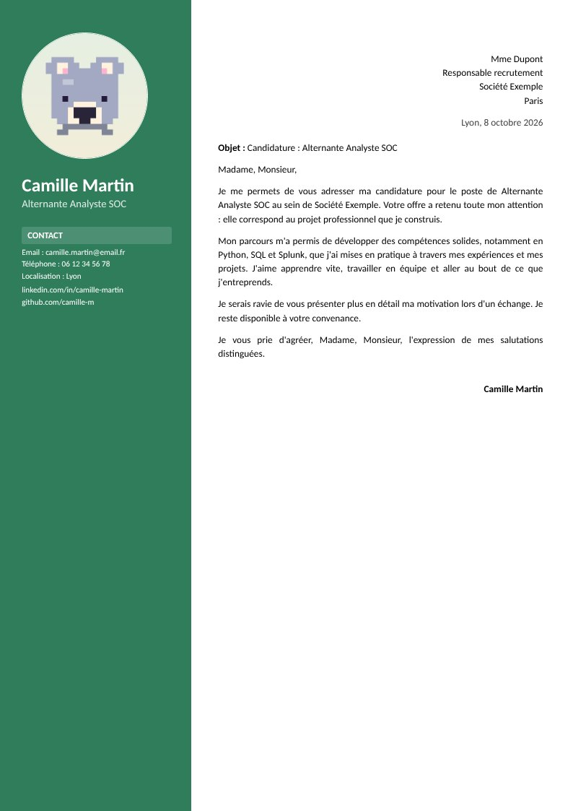
</p>


## 🚀 Installation

### En un clic, sans ligne de commande

1. Sur GitHub, clique sur **Code › Download ZIP**, puis décompresse le dossier.
2. Double-clique sur le fichier qui correspond à ton système :

| Système | Fichier |
| --- | --- |
| Windows | `Lancer.bat` |
| Mac | `Lancer.command` (la première fois : clic droit › Ouvrir) |
| Linux | `lancer.sh` |

3. Au **premier lancement**, l'outil installe tout seul ce qui manque (quelques minutes, une seule fois), puis ouvre Mitady dans ton navigateur. Les fois suivantes, il s'ouvre en quelques secondes. Pour arrêter, ferme la fenêtre noire.

> Le seul prérequis est [Node.js](https://nodejs.org) 18 ou plus récent. Sous Windows, `Lancer.bat` l'installe pour toi s'il manque.

### Avec un terminal

```bash
git clone https://github.com/aymadr/Mitady.git
cd Mitady
npm run setup     # dépendances + navigateur Chromium (une seule fois)
npm start         # puis ouvre http://localhost:3000
```

| Variable | Rôle |
| --- | --- |
| `PORT` | port du serveur (3000 par défaut) |
| `DATA_DIR` | dossier des données, pour essayer l'appli avec un profil vide sans toucher au tien |
| `CHROMIUM_PATH` | utiliser un Chromium déjà installé pour créer les PDF |

### Facultatif

- **Python 3** pour importer et adapter un CV **Word** : `pip install python-docx pypdf` (le lanceur s'en charge s'il le peut). La conversion Word → PDF utilise Microsoft Word ou LibreOffice s'ils sont installés.
- **Une clé API Claude** (Réglages) pour lire les offres, proposer un titre et un résumé de CV, et rédiger l'e-mail et la lettre. Tout le reste fonctionne sans.
- **Un compte e-mail** (Réglages, avec un mot de passe d'application) pour envoyer les candidatures depuis l'appli.

Le serveur n'écoute que sur ta machine. Tes données restent dans le dossier `data/`, jamais envoyé nulle part, jamais commité.

## 🧭 Premiers pas

Au tout premier lancement, un guide plein écran te prend par la main (ton nom, ton animal, ton CV, tes contrats, ton domaine) puis lance la première recherche. Le bouton **?** rouvre le guide, et « Voir la démo en direct » laisse ton animal prendre les commandes du vrai site, sur des offres d'exemple.

1. **Profil** : importe ton CV (PDF ou Word) ou remplis tes rubriques. Choisis ton domaine, ton lieu, tes types de contrat et les sites à interroger.
2. **Chercher** : un clic sur « Chercher des offres ». Tu peux arrêter la recherche à tout moment, les offres déjà trouvées sont gardées.
3. **Offres** : trie par score, ouvre une offre, ajoute les compétences qui manquent à ton profil.
4. **CV et lettre** : choisis ce qui part, ajuste le titre, génère les PDF.
5. **Candidature** : trouve un contact, envoie le message avec les pièces jointes, glisse la carte dans la colonne suivante du **Suivi**.

## 📱 Sur ton téléphone

Le site s'adapte aux petits écrans : une barre d'onglets en bas, le suivi qui se parcourt en glissant, des fenêtres qui remontent du bas. Sur le suivi, **appuie longtemps** sur une carte pour la saisir, puis glisse-la vers une autre colonne (le tableau défile tout seul près des bords).

Un téléphone ne peut pas faire tourner Mitady lui-même : l'appli reste sur ton ordinateur, et le téléphone l'affiche à distance.

1. Lance Mitady sur ton ordinateur, ouvre **Réglages › Sur ton téléphone** et clique sur « Activer l'accès téléphone ». Un QR code et un code à 6 chiffres apparaissent.
2. Connecte le téléphone au **même Wi-Fi** et scanne le QR code avec l'appareil photo : tu es connecté.
3. **iPhone** : dans Safari, **Partager › Sur l'écran d'accueil**. Mitady devient une appli avec son icône (Android : menu ⋮ › Installer l'application).

<details>
<summary>Comment c'est protégé, et hors de chez toi</summary>

- Sans activation, Mitady n'écoute que sur ton ordinateur : rien d'autre ne peut l'atteindre. Une fois activé, tout appareil qui n'est pas l'ordinateur doit saisir le code (5 essais, puis 5 minutes de pause). « Changer le code » déconnecte tous les téléphones, « Désactiver » referme l'accès.
- Le trafic reste dans ta maison, en HTTP : il ne passe pas par Internet. À éviter sur un Wi-Fi public ou partagé avec des inconnus.
- L'ordinateur doit rester allumé avec Mitady lancé. Sur Mac ou Windows, accepte la fenêtre du pare-feu qui demande d'autoriser Node.
- Pour y accéder **en dehors de chez toi**, installe [Tailscale](https://tailscale.com) (gratuit) sur l'ordinateur et le téléphone : l'adresse en `100.x.x.x` qui s'affiche dans les Réglages marche alors partout, toujours avec le code.
- Sans passer par les Réglages : `HOST=0.0.0.0 npm start` ouvre l'accès au lancement (le code s'affiche dans le terminal).
</details>


## 🧩 Pour aller plus loin

<details>
<summary><b>L'éditeur de CV</b> (Profil › Modifier mon CV)</summary>

<br>

Un aperçu en direct, annuler / rétablir (Ctrl+Z, Ctrl+Y) et quatre onglets :

- **Contenu** : infos personnelles (photo recadrable, liens, permis…), rubriques réordonnables (glisser, masquer, renommer) faites de fiches elles aussi masquables et réordonnables. Expérience, formation, projets, certifications, formations complémentaires, distinctions, associations, publications, références, déclaration, rubrique personnalisée, compétences avec niveaux, langues, centres d'intérêt, texte libre.
- **Design** : 21 modèles (14 compatibles ATS, une colonne et texte réel ; 7 plus visuels), marges, taille du texte, interligne, 30 polices (une autre pour le nom), couleurs (simple ou multi, fond sur la page, l'en-tête ou en bordure, accent appliqué élément par élément), en-tête, photo (position, XS à XL, 5 formes, noir et blanc), liens, 9 styles de titres avec icônes, structure des fiches, compétences et langues en texte, pastilles, barres ou points. Chaque carte a des réglages avancés repliables.
- **Document** : langue du CV (français ou anglais), format des dates, format de page (A4 ou Letter), numéros de page.
- **Lettre** : voir ci-dessous.

**Ton Word.** Avec un CV Word, tu peux garder sa mise en page : seuls le titre, le paragraphe de profil et les compétences ajoutées changent, et le PDF est ajusté au même nombre de pages que l'original.

</details>

<details>
<summary><b>La lettre de motivation</b></summary>

<br>

Dans l'onglet **Lettre** de l'éditeur, tu règles ta lettre type : objet, formule d'appel, corps du texte avec des variables (`{{entreprise}}`, `{{poste}}`, `{{contact}}`, `{{competences}}`, `{{ravi}}`…), formule de politesse, lieu, date et place du bloc destinataire. Elle prend le même modèle que ton CV (ou un autre, au choix).

Pour chaque offre, l'onglet **Lettre** de la fiche reprend ce modèle déjà rempli. Tu le retouches, ou tu le fais rédiger par Claude, puis tu génères le PDF et tu le joins à l'e-mail avec ton CV.

</details>

<details>
<summary><b>Ton animal, le décor et l'accord du genre</b></summary>

<br>

<p align="center"></p>

Ton animal est indépendant de toi et de ton CV : choisis l'espèce, la couleur, un accessoire et, si tu veux, un nom. Il se perche sur les barres de recherche, s'endort quand tu es ailleurs et saute, tourne ou danse quand tu le touches. Le décor (arbres, buissons, fleurs, champignons, papillon) est dessiné de la même façon.

À l'accueil, tu indiques aussi si tu es un homme, une femme ou si tu préfères ne pas le préciser : ça accorde l'intitulé du poste sur ton CV. « Alternant(e) Chargé(e) de projet » devient « Alternant Chargé de projet » ou « Alternante Chargée de projet ».

</details>

<details>
<summary><b>Suivi, recherche et petits moments de joie</b></summary>

<br>

- **Suivi** : tu fais glisser une offre d'une colonne à l'autre ; la carte s'incline et les confettis partent quand tu postules.
- **Jalons** : une petite fête pour ta première candidature, puis la 5ᵉ, la 10ᵉ, la 25ᵉ et la 50ᵉ, et à chaque entretien ou offre.
- **Relances** : l'accueil te rappelle les candidatures sans réponse après 7 jours (réglable).
- **Export** : Offres › Exporter produit un fichier Excel.
- **Logos des sites** : dépose un fichier par site dans `public/logos/` pour afficher les logos officiels (voir `public/logos/README.md`).

</details>

<details>
<summary><b>Tes données</b></summary>

<br>

Tout est stocké en local dans `data/`, créé au premier lancement et jamais commité : chaque personne qui clone le projet part d'un profil vide.

| Fichier | Contenu |
| --- | --- |
| `data/db.json` | Profil, réglages et candidatures |
| `data/secrets.json` | Mot de passe d'application e-mail et clé API |
| `data/uploads/` | CV importé et photo |
| `data/cvs/` | CV et lettres générés |

</details>

<details>
<summary><b>Structure du projet</b></summary>

<br>

```
server/
  index.js          API Express
  lib/store.js      persistance JSON
  lib/skills.js     domaines, dictionnaires de compétences, score
  lib/cv.js         import de CV, génération des PDF (CV et lettre)
  lib/cv-render.js  modèles, styles et rendu HTML du CV et de la lettre
  lib/scraper.js    collecte d'offres et recherche de contacts
  lib/dedupe.js     doublons entre sites
  lib/ai.js         fonctions Claude
  lib/mailer.js     envoi SMTP
scripts/
  launch.js         lanceur en un clic
  docx_tools.py     lecture et adaptation d'un CV Word
  koala-logo.js     dessine le logo
  readme-art.mjs    dessine les images animées de ce README
public/             interface (HTML, CSS, modules JS sans build)
docs/               images du README
```

Pour régénérer les images animées : `node --experimental-default-type=module scripts/readme-art.mjs`.

</details>

<div align="center">
<br>


<sub>Fait avec des pixels, un peu de patience et beaucoup de koalas.</sub>
</div>
